<p align="center">
  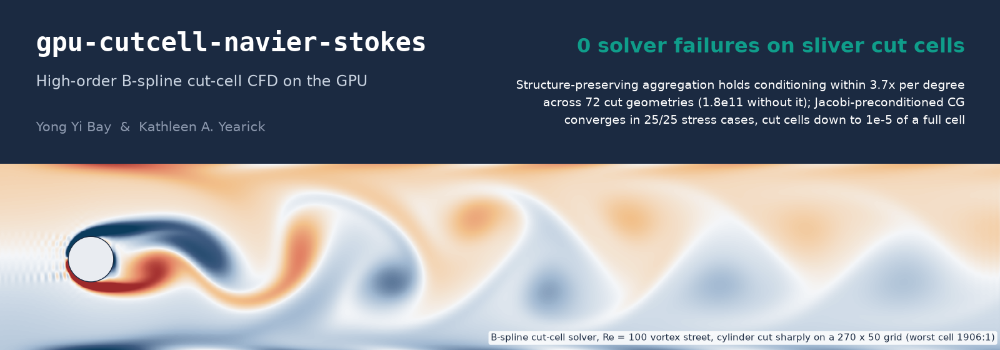
</p>

# gpu-cutcell-navier-stokes

[](https://github.com/bay-yearick-lab/gpu-cutcell-navier-stokes/actions/workflows/tests.yml)
[](LICENSE)
[](cpp/gpu/)
[](pyproject.toml)
[](cpp/)
[](paper/README.md)

Yong Yi Bay and Kathleen A. Yearick

## Overview

This repository solves the small-cell problem for high-order embedded-boundary CFD. When a sharp boundary cuts a background grid it can leave a cell with an arbitrarily small fluid volume; if that cell keeps its own unknown, the explicit time step collapses and the linear systems become ill-conditioned. Here no small cell owns a coordinate. Polynomial-preserving aggregation fills its B-spline coefficients from visible neighbours, and every operator is restricted by the structure-preserving congruence $E^\top(\cdot)E$, which keeps the summation-by-parts and Green identities exact. Stability, mimetic conservation and formal order $p+1$ survive on sharp cuts, with no tuned small-cell penalty (in contrast to cell merging, state redistribution and ghost-penalty methods).

The discretization is co-designed with the solver. Aggregation holds the mass-matrix condition number within 3.7x per degree across 72 cut geometries (up to 1.8e11 without it), so Jacobi-preconditioned CG converges in every stress case, with cut cells down to 1/100,000 of a full cell and an iteration count set by the mesh, not by the sliver. The same sparse systems run GPU-native through CuPy, and 14 CUDA kernel files built on cuBLAS and cuFFT move a full periodic-hill time step onto the device.

The method is an isogeometric finite element (B-spline Galerkin) cut-cell discretization for incompressible and compressible, viscous, heat-conducting Navier-Stokes flow, implemented as C++ and Python numerical software with CUDA kernels, and checked by verification with manufactured solutions.

<p align="center">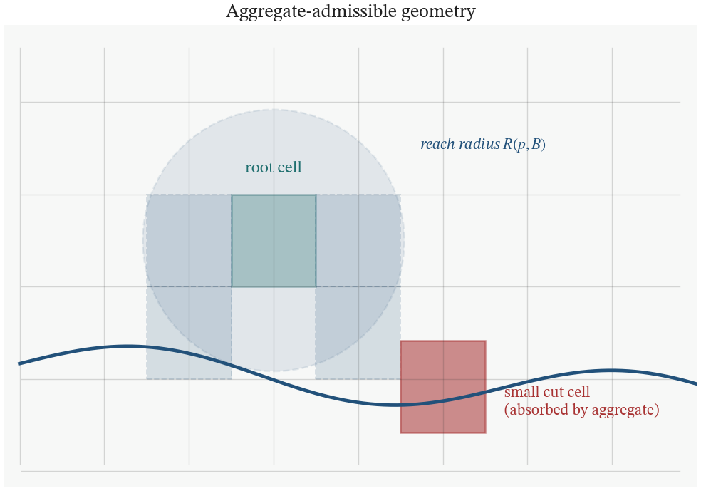</p>

*Small cut cells on a Cartesian grid do not keep their own unknowns. Each one is absorbed into a nearby full root cell by polynomial-preserving aggregation, so no cell in the system is small and the time step and conditioning stay at the background-grid scale.*

## Verify in two minutes

```bash
uv sync
make verify        # or: uv run python code/verify.py
```

recomputes the conditioning gap, the conservation ledger and an observed order from scratch on the CPU:

```
1. Conditioning on a 5-degree oblique cut (6 x 6 elements, offset 0.85 h)
   p   cond(H) aggregated   cond(H) unaggregated   Green residual
   3            2.493e+03              3.676e+07          2.2e-16
   4            7.403e+03              2.795e+09          2.2e-16
   5            4.205e+04              1.825e+11          2.1e-11

2. Compressible Navier-Stokes on a sharply cut 3D box (40 SSP-RK3 steps)
   mass    budget closure   2.58e-15
   mom_x   budget closure   6.78e-20
   mom_y   budget closure   6.78e-20
   mom_z   budget closure   6.78e-20
   energy  budget closure   1.78e-15
   inviscid KE production   2.50e-18
   free-stream residual     7.93e-15

3. 3D cut-box Poisson solve, p = 3, 4/6/8 elements per axis
   observed L2 order 4.37 (formal 4), H1 order 3.34 (formal 3)

all checks passed in 71 s
```

`make test` runs the pytest suite (53 tests: conservation to round-off, SBP identities on aggregated coordinates, convergence slopes, GPU-vs-CPU iteration agreement), and `make cpp-test` runs the 18 C++ manufactured-solution programs.

## Benchmarks and numerical validation

| Evaluation | Result |
| --- | --- |
| Conditioning, 72 oblique cuts (p = 3, 4, 5) | aggregated: within 3.70x per degree; unaggregated: up to 1.8e11 |
| Solver failure rate under sliver stress, p = 4 | 0 of 25 Jacobi-PCG solves fail; cell volume ratios 10 to $10^5$; iterations 104 to 188, independent of the sliver; max relative residual 9.9e-9 |
| Explicit time step, 1D heat-conduction sliver | aggregated step stays at 4.9e-3; unaggregated step collapses to 2.1e-12 (2.3e9 relief) |
| GPU sparse iterative solve, wall-clock | Jacobi-preconditioned CG on GPU (CuPy CSR): 9 to 39x faster than the CPU solver, iteration counts matching to within one |
| Sparse direct vs iterative, 81,344 unknowns | SuperLU: 279 s to factor, 0.63 s per solve; GPU Jacobi-PCG: 0.17 s per solve, no factorization |
| CUDA time stepping | 14 CUDA kernel files (cuBLAS strided-batched solves, cuFFT projection, CSR gather/scatter) for a device-resident periodic-hill time step at $Re_H$ = 5600, p = 3 |
| Schur-complement pressure projection, 3D walled box (C++) | idempotent: weak divergence 3.1e-2 before, 4.3e-17 after |
| Convergence rate on a curved cut, Poisson | observed order 5.14, 7.39, 9.67 for p = 4, 6, 8 (formal 5, 7, 9) |
| Discrete conservation, 3D cut box | compressible: mass 6.1e-15, momentum 2.8e-16, total energy 5.2e-15; incompressible: kinetic-energy ledger 3.1e-16, divergence 7.4e-18 |
| Discrete conservation, 3D sphere cut | worst cell fluid fraction 6.3e-7; kinetic-energy ledger 5.4e-16, divergence 1.7e-17 |
| Vortex shedding past a sharp cylinder, Re = 100 | worst cut cell 1906:1; divergence 1.6e-17 throughout |

<p align="center">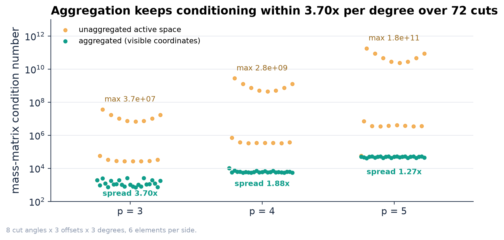</p>

**Figure 1.** Mass-matrix condition number over 72 oblique cuts (8 angles, 3 offsets, p = 3, 4, 5). With aggregation the condition number varies by at most 3.70x within a degree. Without it the condition number reaches 3.7e7, 2.8e9 and 1.8e11.

<p align="center">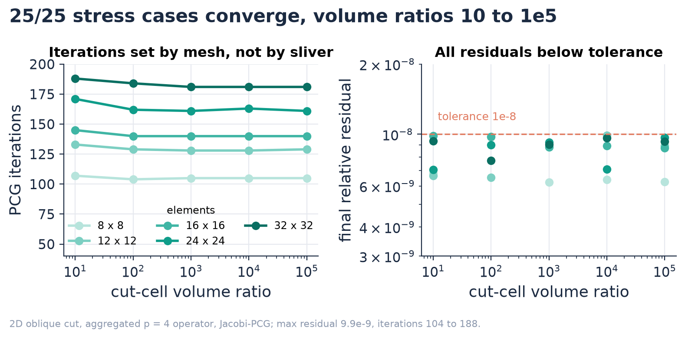</p>

**Figure 2.** Krylov robustness under small cells. 25 aggregated p = 4 systems on a 2D oblique cut, with the full-to-small cell volume ratio swept from 10 to $10^5$. The iteration count depends on the mesh and not on the sliver, and every residual is below the 1e-8 tolerance.

<p align="center">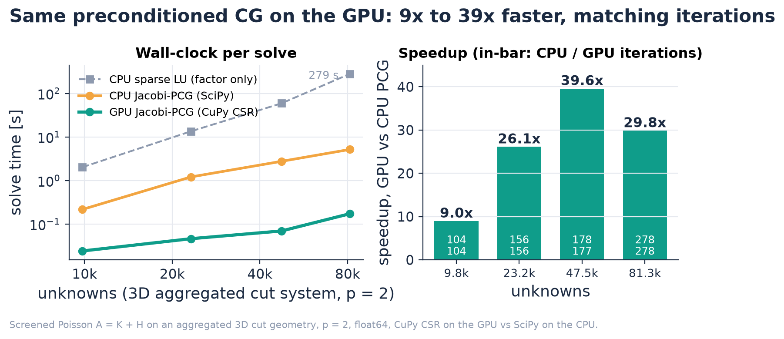</p>

**Figure 3.** The same Jacobi-preconditioned CG on the GPU (CuPy CSR) and the CPU (SciPy) for a screened Poisson system $A = K + H$ on an aggregated 3D cut geometry, p = 2, tolerance 1e-8. Left: time per solve, with the sparse LU factorization time for reference. Right: speedup, with CPU and GPU iteration counts in each bar.

<p align="center">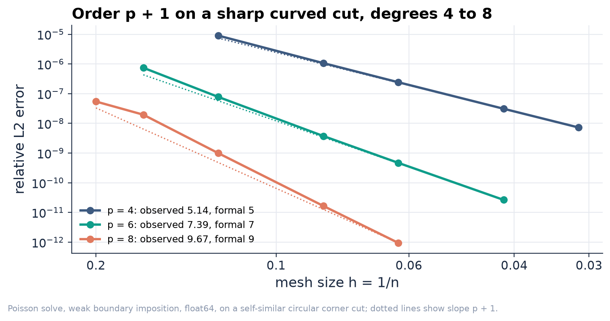</p>

**Figure 4.** Verification by manufactured solutions: relative $L^2$ error of a Poisson solve on a self-similar circular corner cut, boundary data imposed weakly. Dotted lines have slope $p+1$.

<p align="center">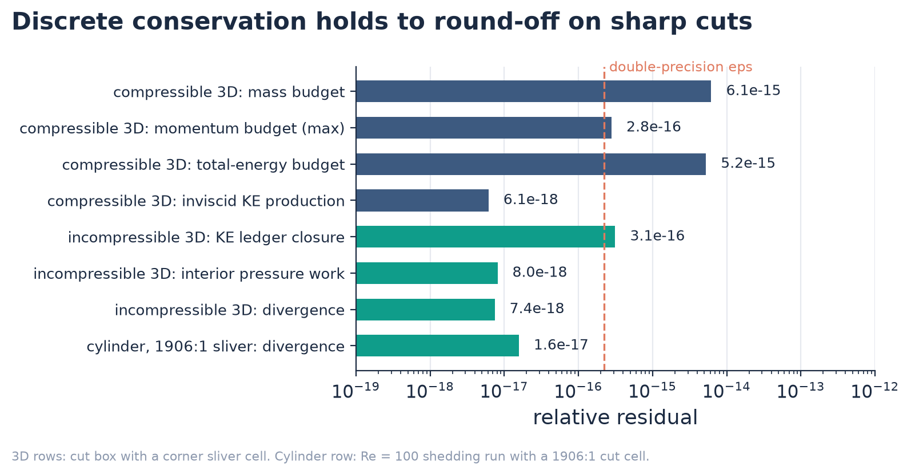</p>

**Figure 5.** Relative conservation residuals. The 3D runs use a cut box whose corner cell is a sliver. The cylinder row is the divergence residual over the full Re = 100 shedding run with a 1906:1 cell.

<p align="center">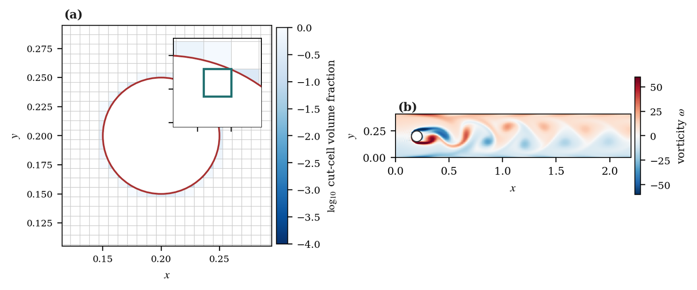</p>

**Figure 6.** Flow past a cylinder cut sharply through a 270 x 50 background grid, Re = 100. (a) Cut-cell volume fraction around the cylinder; the inset shows the smallest cell. (b) Vorticity of the developed vortex street.

<p align="center">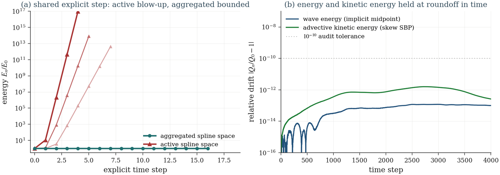</p>

**Figure 7.** Energy on a sharp oblique cut. (a) Under one shared explicit time step the unaggregated space blows up, sooner for larger small-cell ratios, while the aggregated space stays bounded. (b) Relative drift of the wave energy (implicit midpoint) and the advective kinetic energy (skew-symmetric SBP form) stays below 1e-10 over 4,000 steps (measured 1.2e-13 and 1.6e-12).

<p align="center">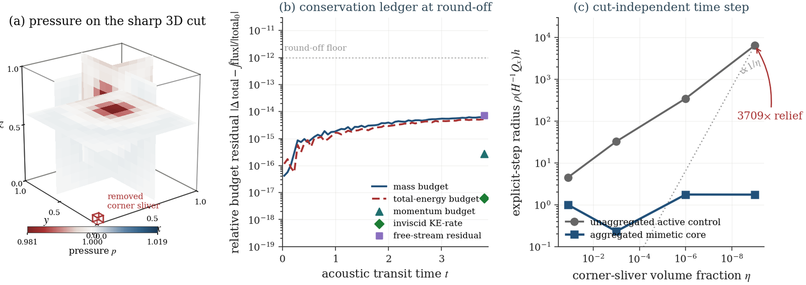</p>

**Figure 8.** Compressible Navier-Stokes on a sharply cut 3D box. (a) Pressure with the removed corner sliver. (b) Mass, momentum and total-energy budgets close at round-off over the run. (c) The explicit spectral radius stays at background scale as the corner volume fraction falls, a 3709x step-size relief over the unaggregated operator.

<p align="center">
  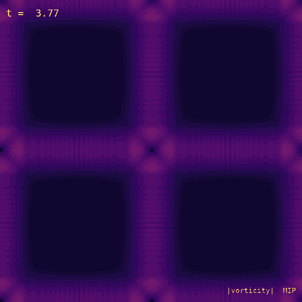
  &nbsp;
  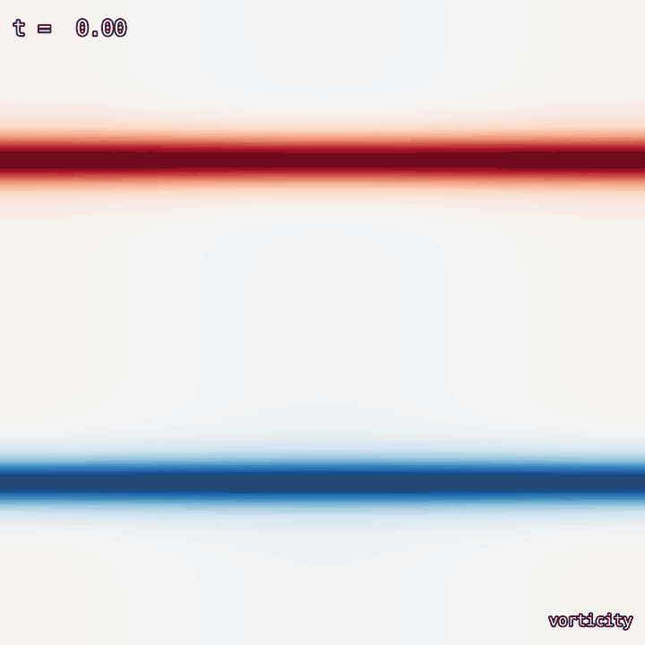
</p>

**Figure 9.** Output of the C++ solver in `cpp/`. Left: maximum-intensity projection of vorticity magnitude for a 3D periodic vortex array breaking down into turbulence. Right: 2D compressible Kelvin-Helmholtz roll-up with the energy-conserving split form.

## GPU implementation

**Sparse Krylov path.** Aggregated systems are sparse, symmetric and conditioned like background-grid systems. The same CSR matrices run through SciPy on the CPU or CuPy on the GPU with identical tolerances, so the GPU path is a drop-in for the CPU one and the iteration counts can be compared directly. For structured periodic-hill and channel cases a fast-diagonalization direct solver replaces CG: per-axis eigendecompositions on boxes and channels, and a spanwise Fourier transform with one dense inverse per mode on the periodic hill.

**CUDA kernels.** `cpp/gpu/` holds 14 `.cu` files that build the periodic-hill time step piece by piece: dense 2D operator applies as cuBLAS DGEMM, per-Fourier-mode solves as `cublasDgemmStridedBatched`, sampling and gradients as a custom CSR gather kernel, the Galerkin load (the adjoint of sampling) as an `atomicAdd` scatter, a direct spanwise DFT, the skew-symmetric convection, and a device-resident SSP-RK3 step. A separate kernel applies the periodic B-spline operators with one thread per grid line and projects the pressure with cuFFT. Each kernel is diff-tested against the CPU implementation to round-off.

**GPU memory hierarchy.** Velocity and pressure fields stay resident on the device across the RK3 stages; the host copies a reduced field only every K steps to accumulate statistics. Spectral coefficients are stored mode-major, so one `cublasDgemmStridedBatched` call applies a different dense inverse to every spanwise Fourier mode instead of a loop of per-mode matrix-vector products. A low-memory variant (`gpu_dns_lowmem.cu`) aliases the advection product buffers onto gradient and sample buffers that are dead at that point, which cuts the device memory footprint of the step.

## Method

**B-spline cut-cell spaces.** A tensor-product B-spline space of degree $p$ is laid on a background grid. Volume, boundary and trace forms are integrated over the sharp cut domain (curved-panel quadrature for curved boundaries), so the geometry is never smoothed or staircased. Two routes share the space: BMG, a same-space Galerkin derivative, and BMF, a staggered flux pair with a mixed Green identity for velocity and pressure.

**Structure-preserving aggregation.** A coefficient whose support carries less than a set fraction of background-cell mass is not an unknown. Its value comes from a local polynomial-preserving extension over interior neighbours, and the extension matrix $E$ acts on every assembled operator as $E^\top(\cdot)E$. Large extension weights only multiply rows with small cut mass, so the aggregated mass matrix stays close to the background-grid one, and both conditioning and the explicit step size are set by $h$, not by the smallest cut.

**C++ CPU solver.** The CPU code in `cpp/` is header-only C++17 with OpenMP and no external numerical libraries. On periodic and box domains it never forms a multidimensional matrix: each derivative and mass solve reduces to independent 1D banded or circulant line solves that run in parallel, and the pressure solve is a per-axis fast diagonalization (the layout `dns_gpu.cu` maps to one CUDA thread per line). A manufactured-solution suite (`make test`) checks operators, solvers and observed convergence order.

### Discrete conservation

The convective terms use a fully conservative skew-symmetric discretization, the average of the advective and divergence forms, $\tfrac12\left[(\mathbf w\cdot\nabla)\mathbf u + \nabla\cdot(\mathbf w\otimes\mathbf u)\right]$, built from SBP operators. With mass matrix $H_{ij}=\int_{\Omega}\phi_i\phi_j\,dx$ and $Q_{ij}=\int_{\Omega}\phi_i\,\partial\phi_j\,dx$ integrated over the true cut domain, the B-spline basis gives the cut-domain Green identity and its SBP form ($D = H^{-1}Q$, boundary restriction $R$, boundary weights $B$):

$$
Q + Q^\top = R^\top B R, \qquad H D + D^\top H = R^\top B R .
$$

Aggregation writes $\mathbf u = E\hat{\mathbf u}$ with $E\mathbf 1 = \mathbf 1$ (polynomial preservation). Because a congruence distributes over sums and transposes, the identity holds unchanged on the aggregated coordinates:

$$
E^\top Q E + \left(E^\top Q E\right)^\top = E^\top\left(Q + Q^\top\right)E = (RE)^\top B\,(RE).
$$

Partition of unity gives $Q\mathbf 1 = 0$, so $\mathbf 1^\top Q = (R\mathbf 1)^\top B R$: the discrete integral of any flux-form derivative equals its boundary flux, and mass and each momentum component change only through the boundary. For kinetic energy $K = \tfrac12\mathbf u^\top H\mathbf u$, the convection operator is skew-symmetric, $C_{\mathrm{skew}}^\top = -C_{\mathrm{skew}}$, once its boundary part is moved into the boundary work $b_\partial$; the divergence is the negative adjoint of the gradient, and the stiffness $A$ is symmetric positive semidefinite, giving the semi-discrete ledger

$$
\frac{dK}{dt} = \underbrace{\mathbf u^\top C_{\mathrm{skew}}\,\mathbf u}_{=\,0} + \underbrace{p^\top G^\top\mathbf u}_{=\,0} - \nu\,\mathbf u^\top A\,\mathbf u + b_\partial \;\le\; b_\partial .
$$

The same steps hold for $E^\top H E$, $E^\top C_{\mathrm{skew}} E$ and $E^\top A E$, so the energy estimate does not depend on how small the cut cell is. The measured residuals follow each identity: the inviscid kinetic-energy production of the compressible scheme is 6.1e-18, the incompressible kinetic-energy ledger closes at 3.1e-16 with interior pressure work at 8.0e-18, and the divergence stays at 1.6e-17 throughout the cylinder run with its 1906:1 cell.

## Where things live

| Method component | Implementation |
| --- | --- |
| B-spline cut-cell mass, derivative and stiffness forms on the sharp cut domain | `code/cut_spline_sbp.py` (1D), `code/oblique_cut_sbp.py` (2D oblique), `code/circular_corner_sbp.py` (2D curved), `code/cut_3d_sbp.py` (3D box) |
| Curved-domain moment quadrature (dimension reduction on implicit geometry) | `code/quad_curved.py` |
| Polynomial-preserving aggregation $E$ and the congruence $E^\top(\cdot)E$ | `code/local_aggregation.py`, `code/highp_cut_basis.py`, `polynomial_preserving_extension_3d` in `code/bell_3d_core.py` |
| BMG / BMF cut routes, Green and mixed Green identities, pressure work | `code/cut_mimetic_routes.py`, `code/cut_mimetic_routes_2d.py` |
| Weak (symmetric penalty) Dirichlet Poisson solve, order ladder | `code/cut_pde_solve.py`, `code/highp_pde_solve_ladder.py` |
| Jacobi-preconditioned CG, CPU (SciPy) and GPU (CuPy CSR) backends | `code/fast_solver_backends.py` |
| Fully conservative skew-symmetric incompressible Navier-Stokes, 3D cut box | `code/tg3d_fully_conservative.py` |
| Split skew-symmetric compressible Navier-Stokes, 3D cut box | `code/comp3d_solver.py` |
| Cylinder vortex shedding with a 1906:1 cut cell | `code/channel_cylinder_flow.py` |
| Banded and cyclic line solves (reduce-solve-expand) | `cpp/include/core/linalg.h`, `cpp/include/operators/bm_apply.h` |
| Fast-diagonalization direct saddle solver, periodic hill | `cpp/include/cut/hill_fastdiag.h`, `cpp/include/solvers/fastdiag3.h` |
| CUDA: cuBLAS DGEMM apply, strided-batched per-mode solves, CSR gather, `atomicAdd` scatter, SSP-RK3 step | `cpp/gpu/gpu_apply2d.cu`, `gpu_fastdiag.cu`, `gpu_sample.cu`, `gpu_load.cu`, `gpu_step.cu` |
| CUDA: one-thread-per-line periodic apply with cuFFT projection | `cpp/gpu/dns_gpu.cu` |
| GPU benchmark | `benchmarks/gpu_pcg_benchmark_3d.py` |

## Layout

```
gpu-cutcell-navier-stokes/
  README.md  LICENSE  CITATION.cff  pyproject.toml  uv.lock  Makefile
  code/                        Python: cut-cell assembly, aggregation, solvers, experiments
    cut_spline_sbp.py  cut_assembly.py  cut_3d_sbp.py  local_aggregation.py
    oblique_cut_sbp.py  quad_curved.py  highp_cut_basis.py  circular_corner_sbp.py
    fast_solver_backends.py    CPU (SciPy) and GPU (CuPy) PCG backends
    fast_solver_workbench.py   small-cell stress test
    channel_cylinder_flow.py  comp3d_solver.py  tg3d_fully_conservative.py  ...
    verify.py                  one-command CPU verification (make verify)
    tests/                     pytest suite
    results/                   CSV, JSON and NPZ result files behind the figures
  benchmarks/                  GPU vs CPU PCG benchmark script, results table
  cpp/                         C++17 header-only solver (OpenMP)
    include/{core,operators,solvers,cut,io}/
    apps/{incompressible,compressible,acoustics,benchmarks}/
    tests/                     manufactured-solution (MMS) regression suite
    gpu/                       14 CUDA kernel files, Makefile, results/
    data/                      MMS convergence tables, regression log
  tools/                       make_readme_assets.py (regenerates assets/)
  paper/                       manuscript status
  assets/                      figures used in this README
```

## Reproducing

Python (CPU, Python 3.10+, uv):

```bash
uv sync
make verify                                         # headline checks, about 1-2 minutes
uv run pytest -q                                    # code/tests
uv run python code/fast_solver_workbench.py --quick # stress-test smoke run
uv run python code/s6_oblique_sweep.py              # Figure 1 data -> code/results/
uv run python code/highp_pde_solve_ladder.py        # Figure 4 data -> code/results/
make assets                                         # redraw assets/ from the result files
```

Python (GPU, needs an NVIDIA GPU and CUDA 12.8 or newer):

```bash
uv sync --group gpu
uv run python benchmarks/gpu_pcg_benchmark_3d.py --quick
uv run python benchmarks/gpu_pcg_benchmark_3d.py    # writes benchmarks/results/gpu_solver_benchmark_3d.{csv,json}
```

C++ and CUDA (g++ or clang++ with C++17 and OpenMP; CUDA toolkit 12.8+ with cuBLAS and cuFFT):

```bash
make -C cpp -j                 # CPU solver, all apps into cpp/bin/
make -C cpp test               # MMS regression suite
make -C cpp gpu                # CUDA kernels (nvcc, -arch=sm_120)
make -C cpp gpu ARCH=sm_89     # another GPU architecture
make -C cpp gpu-test           # each kernel diff-tested against the CPU reference
```

## Citation

```bibtex
@unpublished{bay2026smallcutcell,
  author = {Bay, Yong Yi and Yearick, Kathleen A.},
  title  = {A Small Cut Cell Must Not Own a Coordinate: High-Order
            Summation-by-Parts {B}-spline Methods for Sharp Embedded
            Boundaries without a Tuned Small-Cell Penalty},
  note   = {In preparation},
  year   = {2026}
}
```

## License

MIT. See [LICENSE](LICENSE).
